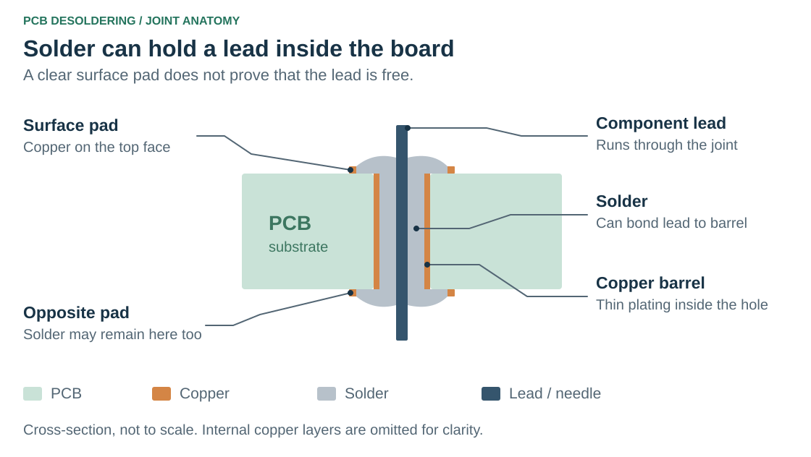

# PCB Desoldering Guides

Two practical bench guides for removing through-hole components and reopening solder-filled holes on a printed circuit board (PCB).

## Choose a guide

| What is on the board? | Guide | Result |
| --- | --- | --- |
| A component is still held by solder | [Remove a through-hole component](guides/remove-through-hole-components.md) | Free the leads with a pump and wick, then lift out the component. |
| The component is out, but its hole is blocked | [Clear a blocked through-hole](guides/clear-blocked-through-hole.md) | Form an opening with a stainless-steel needle while the solder cools. |

The guides cover different stages of a repair. Start with component removal when a lead is still in the hole. Use the needle method only after the component is out and ordinary pumping or wicking has left a solder plug.

## Understand the joint

A plated through-hole has a copper lining, called the **barrel**, that connects copper on the two faces of the board and may connect to internal layers. Solder inside that barrel can hold a lead even when the visible pad looks clear.

The diagram uses green for the PCB, orange for copper, grey for solder, and dark blue for the component lead. It is a schematic cross-section, not a dimensioned drawing.

## Before working

Disconnect power and batteries, account for stored capacitor charge, and support the board securely. Wear eye protection, ventilate fumes, and keep fingers away from hot metal. Let the board cool between repeated attempts. Stop if a pad moves, the board scorches, or the barrel appears damaged.

Both guides assume basic soldering skills. Follow the equipment and board manufacturer's instructions for the assembly you are repairing.
