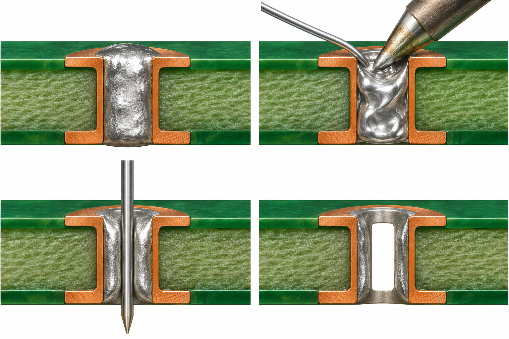
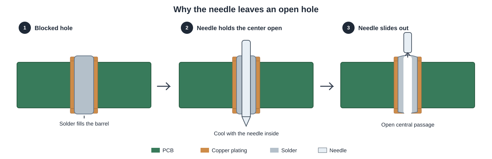

# Clearing a Solder-Blocked PCB Through-Hole with a Needle

**A practical fix for a hole that stays plugged after the component has already been removed.**

You remove a through-hole component, but the hole is still filled with solid solder. The desoldering pump gets little or nothing out—even after several attempts. You need the hole open to install another component, but you do not want to damage the copper plating by drilling or forcing a tool through it.

## The main idea

**Instead of trying to suck the last solder out, temporarily occupy the center of the molten solder with a smooth, solder-resistant needle.**

Add a little fresh solder to help the old plug melt evenly, push a **suitably sized stainless-steel needle** through while the solder is fully molten, and hold it still as the solder cools. Then gently pull the needle straight out. Because ordinary electronics solder generally does not wet clean stainless steel well, the needle can slide free and **leave an open passage through the solder**.

**In one line:** Fresh solder → melt the plug → insert needle → let it solidify → withdraw needle → verify the hole.

> **Important:** This method is for a hole **after the component has been removed**. It is a fallback when ordinary pumping or wicking has failed, not a reason to keep heating a damaged pad. Never drive a needle through solid solder.

## Why the hole stays blocked

On a plated-through-hole PCB, the hole has a thin copper lining (the **barrel**). Solder can remain inside this barrel after the component lead has been pulled out. A pump may remove solder from the visible pad while leaving a solid plug deeper inside. Larger copper planes can also draw heat away, so the surface looks molten even though the entire plug has not melted.

The needle works differently from a pump: **it creates space mechanically while the solder is liquid**, then preserves that space while the solder freezes.

*Simplified cross-section; not to scale. Some solder may remain bonded to the copper barrel after the central passage is opened.*

## What you need

| Tool or material | Why you need it |
| --- | --- |
| Temperature-controlled soldering iron | Fully melts the solder plug |
| Small amount of fresh electronics solder | Improves contact and heat transfer to the old solder |
| Electronics-grade flux | Helps the solder flow more evenly |
| **Smooth, clean stainless-steel desoldering needle** | Displaces the molten solder without readily bonding to it |
| Tweezers or pliers | Hold the needle without touching the hot metal |
| PCB holder | Keeps the board steady |
| Magnifier or good lighting | Helps verify the opening and inspect the pad |
| Isopropyl alcohol and suitable swab (optional) | Clean compatible flux residue after cooling |

**Choose the needle carefully:** It should fit easily inside the plated hole and be slightly smaller than the opening you need. A blunt-tipped stainless-steel desoldering needle is preferable to a sharp sewing needle. Avoid rough, plated, or easily solder-wetted needles: the solder can grip them instead of letting them slide out.

## Step-by-step

### 1. Inspect and secure the PCB

Disconnect power and batteries; ensure capacitors are safely discharged. Clamp the PCB gently so it cannot shift. Inspect both sides of the hole for lifted pads, damage, or nearby components that might be affected by heat.

If the copper pad or plated barrel is already coming loose, **stop**; forcing a needle through can make the damage worse.

### 2. Add flux and a little fresh solder

Put flux on the blocked hole and touch a small amount of fresh electronics solder to the pad.

This may seem counterintuitive—you are adding solder to a hole you want to clear—but the fresh solder makes better thermal contact with the old plug and helps everything reflow together. **Use only a little.**

### 3. Melt the *entire* solder plug

Heat the solder and pad with a suitably sized, clean iron tip until the solder **through the hole** becomes molten, not just the top surface. If it refuses to melt promptly, improve tip contact or pause and reassess rather than pressing harder or overheating the board.

A ground-plane connection may need more thermal capacity or controlled preheating, not repeated prolonged contact with a small tip.

### 4. Insert the stainless-steel needle

While the solder is fully molten, **gently slide the needle straight through the center of the hole**. A second hand with tweezers or pliers is helpful; keep your fingers away from the needle and iron.

Do **not** push through resistance. If the needle stops, the solder may not be molten throughout, or the needle may be too large. Withdraw, let the board cool if needed, then reflow and try with a more suitable needle.

### 5. Let the solder solidify around the needle

Remove the soldering iron while **holding the needle steady**. Let the solder freeze naturally with the needle occupying the center.

The needle acts as a temporary form that prevents solder from filling that central space.

### 6. Pull the needle straight out

Once the joint has cooled and hardened, **gently withdraw the needle in a straight line**. It should slide out and leave a hole through the solder plug.

If it sticks, **do not twist or yank it**. Reheat the solder gently to free the needle, then reconsider the needle material, surface, or size.

### 7. Inspect, test, and clean

Look through the opening with a light or magnifier. Test that the replacement component lead fits **without force**. If the passage is too small, use a correctly sized needle in a separate careful reflow operation rather than drilling out the copper plating.

Clean suitable flux residue after the PCB cools, and verify that the pad and barrel are intact before soldering a replacement component.

## Why it works

Three things happen:

1. **Fresh solder and flux help reflow the old plug.** The solder inside the plated-through hole becomes liquid.
2. **The needle displaces the liquid solder.** It occupies the space you want to reopen.
3. **The solder hardens around the needle.** A suitable smooth stainless-steel needle usually does not bond strongly to the solder, so withdrawing it leaves a central passage.

It is **not** a desoldering pump: you are not removing all the solder from the barrel. You are opening a useful path through it. The remaining solder can later be reflowed when installing the replacement lead.

## Troubleshooting

| Problem | Likely cause | What to do |
| --- | --- | --- |
| Needle will not go through | Plug is not fully molten, or needle is too thick | Add flux, improve heating, choose a smaller needle; never force it |
| Needle is stuck after cooling | Solder has gripped the surface, or there is mechanical interference | Reheat and release it gently; do not yank or twist |
| Hole is open but still too small | Needle diameter was too small | Reflow with a suitably sized desoldering needle; confirm the replacement lead fits freely |
| Only the top surface melts | Internal copper or ground plane is drawing heat away | Use better tip contact or proper preheating; do not keep cooking the pad |
| Pad lifts or changes shape | Excess heat or force | Stop immediately; inspect for damaged copper plating |
| Needle comes out but the hole closes | Solder was still soft when the needle was removed | Reinsert while fully molten, hold it steady, and wait until it solidifies |

## Important precautions

- **Work on an unpowered PCB.** Some equipment contains hazardous stored charge even when unplugged.
- **Use a blunt, smooth stainless-steel needle**, ideally one sold for electronics desoldering. Sharp points can injure you or scrape plated barrels.
- **Never force the needle** through partially solid solder. The plated barrel is thin and easily damaged.
- **Do not drill out the hole** as a routine fix; a drill can remove copper plating, including connections to internal PCB layers.
- **Limit heat exposure.** If the board discolors, the pad moves, or repeated attempts fail, stop and consider a temperature-controlled vacuum desoldering tool or professional rework.
- **Wear eye protection, ventilate soldering fumes, and use pliers** for the hot needle. Wash your hands after handling solder.

## Quick recap

**Blocked hole → add a little solder → fully melt → insert a smooth stainless needle → cool → pull out → open hole.**

The key is **not stronger suction**. It is using the needle as a temporary spacer while the solder changes from liquid back to solid.

## Further reading

- [Electrical Engineering Stack Exchange: solder stuck in a small hole](https://electronics.stackexchange.com/questions/716379/tips-on-removing-solder-stuck-in-very-small-hole/716391) — practical discussion of stainless-steel desoldering needles.
- [Circuit Technology Center: plated-through-hole preparation](https://www.circuitrework.com/guides/7-1-2.html) — professional rework guidance on heat transfer, solder-filled holes, and avoiding damage.
- [Hackaday: Have You Ever Tried Desoldering Needles?](https://hackaday.com/2017/04/03/have-you-ever-tried-desoldering-needles/) — overview of desoldering-needle use.

---

*Illustrations are explanatory, not to scale. Follow the board manufacturer's repair guidance for valuable, high-reliability, or multilayer assemblies.*
