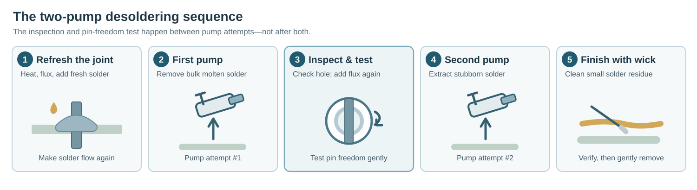
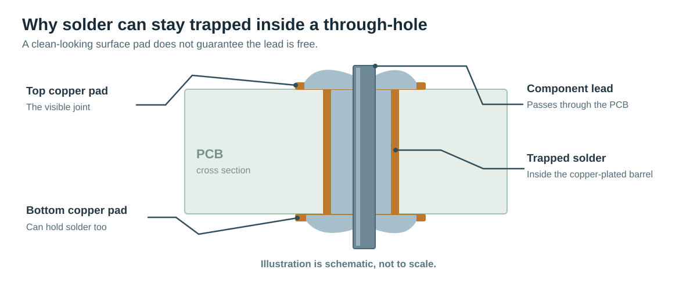

# Desoldering Stubborn Through-Hole Components

**A practical pump-and-wick guide for old, oxidized solder.**

When a through-hole component refuses to come out, the problem is often **not a lack of heat**. Old solder may have oxidized, stopped flowing easily, or remained trapped inside the plated hole that connects the two sides of the circuit board.

**The main idea: make the old joint flow again *before* trying to remove the solder.** Reflow the joint with flux and fresh solder, make a **first pump attempt**, check the hole and test whether the pin is free, then make a **second pump attempt** before cleaning up with solder wick. Only remove the component once **every pin moves freely**.

## At a glance: two separate pump attempts

1. **Secure the board**, heat the joint, then add flux.
2. **Refresh the solder**, and make the **first pump attempt** while it is fully molten.
3. **Assess the hole**, add flux again, and gently **test whether the pin is free** while the joint is molten.
4. **Make the second pump attempt** to remove solder still holding the pin.
5. **Use solder wick** to clean up any small remaining deposits.
6. **Confirm clearance**, remove the component gently, and clean the board.

The two pump attempts are intentionally **separate**. The inspection, fresh flux and pin-freedom test *between them* are important parts of the original method, not optional details to skip.

> **Important:** Never pull a component out against a soldered pin. That can tear a copper pad or the plated barrel out of the PCB.

## Why through-hole solder is difficult to remove

A through-hole joint isn't just a blob of solder on the surface. On many PCBs, the inside of the hole is plated with copper, and solder can connect the component lead to the barrel **through the full board thickness**. Clearing the visible pad on one side does not always free the lead.

Three common reasons a joint stays stuck:

- **Oxidation:** Old solder and dirty surfaces don't wet and flow as readily. Flux helps remove surface oxides while you heat the joint.
- **Solder inside the hole:** Even after a pad looks clean, a thin ring of solder may still hold the lead in the plated barrel or on the other side.
- **Heat sinking:** Large copper areas, ground planes, and thick component leads draw heat away, making it harder to melt the joint evenly. Lead-free alloys can also require more heat than tin-lead solder.

This is why repeatedly increasing the iron temperature or pulling harder usually isn't the best solution.

## What you need

| Tool or material | Purpose |
| --- | --- |
| Temperature-controlled soldering iron | Heats the lead and pad together |
| Flux suitable for electronics | Improves wetting and helps old solder flow |
| Fresh electronics-grade solder | Refreshes the joint and improves thermal contact |
| Spring-loaded desoldering pump | Removes most of the molten solder quickly |
| Desoldering braid (solder wick) | Absorbs thin films and small remaining deposits |
| PCB holder or stable work surface | Stops the board moving while you work |
| Tweezers or small pliers | Checks whether leads are free; helps lift the part gently |
| Isopropyl alcohol and brush | Removes compatible flux residues after the board cools |

**Safety:** Disconnect power and batteries before working. Be aware that capacitors can remain charged, particularly in mains-powered equipment. Use eye protection and ventilation, avoid touching hot tools or molten solder, and wash your hands after handling solder. If you're unfamiliar with safely discharging high-voltage capacitors, don't work on that board.

## Step-by-step method

This follows the **same order as the original guide**, including both pump attempts.

### 0. Secure the board

Fix the PCB so it does not move when you operate the pump. Identify all pins, and support the board without bending it.

### 1. Heat the joint

Touch the iron tip to the solder joint so the **pad and component pin heat together**. Begin around **320–350°C** for typical tin-lead solder; some lead-free joints may require around **350–380°C**, depending on the board and iron. These are starting settings, not guarantees.

The solder should melt promptly. If it does not, improve tip contact rather than holding high heat on the pad for a long time.

### 2. Apply flux

Add suitable electronics flux to help the oxidized joint wet and flow. This is especially helpful when old solder has lost its original flux.

### 3. Refresh the solder, then make the **first pump attempt**

1. Melt a **small amount of fresh solder** into the old joint. The goal is to make the existing solder flow, not to add a large blob.
2. Prime the desoldering pump and position it close to the joint, roughly perpendicular to the board.
3. Heat the **pin and pad together** until all the solder is liquid.
4. Move the iron aside, immediately place the pump nozzle over the molten joint, and **trigger the first suction**.

The transition from iron to pump must be quick. If the solder has already solidified, the pump will remove little or nothing.

### 4. Assess the hole

Inspect the plated-through hole. The visible pad may be clear while some solder still remains inside the hole or on the opposite side of the PCB.

**Do not assume the lead is free just because the pad looks clean.**

### 5. Apply flux again

Add fresh flux to the stubborn joint to help the remaining solder reflow in the next operation.

### 6. Test pin freedom

1. Add a little solder if needed to help the remaining solder melt evenly.
2. Heat the **pin and pad together** until the joint is molten.
3. **Gently test whether the lead can move** using the iron tip, without pushing hard, prying, or bending it.

If the lead resists, solder is still bonding it to the plated barrel or the far side of the board. **Do not force it out.** This test is done *before* the second pump attempt.

### 7. Make the **second pump attempt**

1. Reheat the pad and pin until the remaining solder is **fully molten**.
2. Keep the pump primed and ready next to the joint.
3. Quickly move the iron away, place the nozzle over the joint, and **trigger the pump a second time**.

This is a distinct second attempt **after checking pin freedom**, intended to extract the stubborn solder that survived the first attempt. If the lead is already completely free, avoid needless reheating.

### 8. Clean the residual solder with wick

Use solder wick for the small amount of solder that may still be attached to the pin or pad:

1. Place a clean, appropriately fluxed section of wick over the remaining solder.
2. Press the soldering iron **on top of the braid** until the solder flows into it.
3. Lift the iron and braid **together while hot**. Never pull braid away while it is soldered to a pad.

**Pump versus wick:** The pump extracts the main mass of molten solder, including solder in the hole; wick is for **leftover films and small deposits**. Wick is the finishing operation, **not a replacement for the second pump attempt**.

### 9. Confirm the hole is clear

Check the hole and **every component lead**. A pin should no longer be held by solder. If solder remains, reapply flux, heat and use wick as needed; let the board cool between attempts to avoid damaging pads.

### 10. Remove the component

From the opposite side of the PCB, **gently lift or pull the component without force**. If it catches, stop and inspect the remaining connections. Never lever against a pad.

### 11. Clean the board

After the board cools, clean compatible flux residues with isopropyl alcohol and a suitable brush or swab. Let the PCB dry completely and inspect the solder pads and plated holes for damage.

## Soldering iron temperature: a starting point

The temperature set on the iron is **not** the same as the solder's melting temperature. These are approximate starting ranges from the original guide, **not universal settings**:

| Solder type | Suggested starting iron setting |
| --- | --- |
| Traditional tin-lead solder | **320–350°C** |
| Common lead-free solder | **350–380°C** |

Use the lowest setting that lets you reflow the **whole joint promptly**. Tip size, thermal contact, board thickness, and connected copper all affect the result. A clean, suitably sized chisel tip and fresh solder often help more than simply turning up the temperature. Stop if a pad discolors, lifts, or begins to separate.

## Troubleshooting

| What you see | Likely explanation | What to try |
| --- | --- | --- |
| Solder beads up or won't flow | Oxidation or poor wetting | Add flux, clean the iron tip, and mix in fresh solder |
| Solder melts but the pump removes little | Solder cooled before suction or nozzle missed the joint | Position the pump first and shorten the movement from iron to pump |
| The visible pad is clean but the pin is stuck | Solder remains inside the plated hole or on the other side | Follow the second pump attempt after refluxing and testing the pin; finish with wick on residue |
| Wick appears not to absorb solder | Braid is saturated, dry, or not heating properly | Use a clean section, add suitable flux, and press the iron onto the braid |
| A large ground pin won't melt evenly | Copper planes draw away heat | Use an appropriately sized tip and adequate thermal contact; consider suitable PCB preheating equipment |
| The component won't lift | At least one pin or mechanical tab is still bonded | Stop pulling and inspect **every** connection |

## When to stop

If the pad starts lifting, the board is scorching, or a lead remains stuck after repeated controlled attempts, **stop rather than keep forcing it**. A temperature-controlled desoldering gun or professional rework setup may be safer for a dense multilayer board or a valuable PCB.

## Quick takeaway

**Heat → flux → fresh solder → first pump → inspect → flux again → test pin freedom → second pump → wick → verify → remove → clean.**

The goal is **not to overpower old solder with more heat**. It is to make the joint flow, remove solder from both the surface and inside the plated hole, and free the component *without damaging the PCB*.
